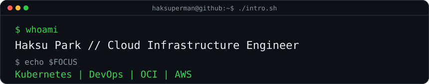
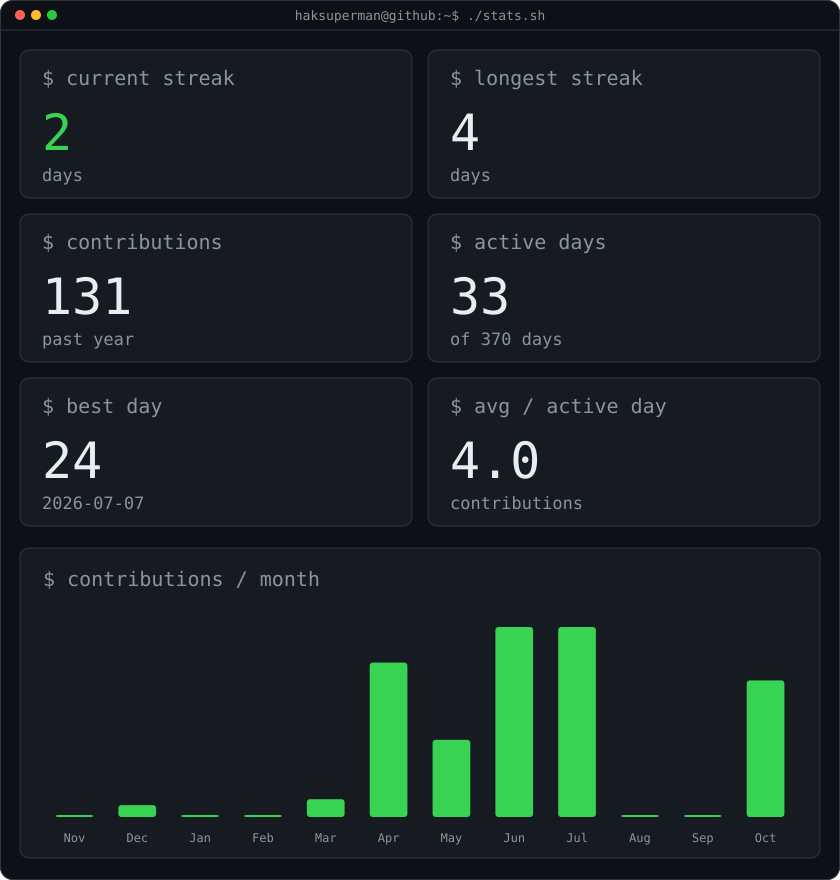
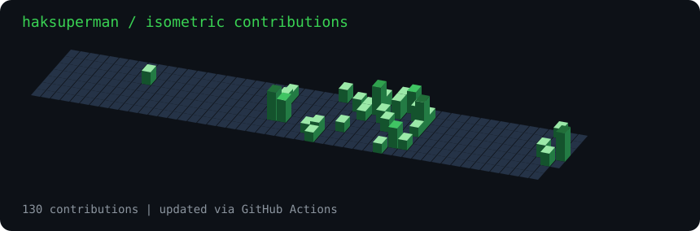

 

### `haksuperman@github ~ $ ./contributions.sh`

 

### `haksuperman@github ~ $ whoami`

<table>
  <tr>
    <td valign="top"></td>
    <td valign="top"></td>
  </tr>
</table>

 

### `haksuperman@github ~ $ cat ~/tech-stack.txt`

`Oracle Cloud Infrastructure` · `AWS` · `Kubernetes` · `Docker` · `Linux` · `CI/CD`

 

### `haksuperman@github ~ $ ls ~/featured-projects`

<table>
  <tr>
    <td width="33%" align="left" valign="top">
      <a href="https://github.com/haksuperman/OCI-ResourceExtractor"><b>OCI Resource Extractor</b></a>
      
OCI 리소스 정보를 수집하고 Excel 운영 리포트를 생성하는 Python 도구

    </td>
    <td width="33%" align="left" valign="top">
      <a href="https://github.com/haksuperman/eks-book-practice"><b>EKS Book Practice</b></a>
      
Kubernetes 및 AWS EKS 실습 기록

    </td>
    <td width="33%" align="left" valign="top">
      <a href="https://github.com/haksuperman/mini-commerce-3tier"><b>Mini Commerce 3-Tier</b></a>
      
React, FastAPI, MySQL, Redis 기반 3-Tier 애플리케이션 실습

    </td>
  </tr>
</table>

 

### `haksuperman@github ~ $ ./contributions-3d.sh`

<!--
Profile artwork is generated by scripts/render_profile.py through
.github/workflows/update-profile.yml. The five SVGs are self-hosted
and refreshed on schedule or through a manual Actions run.
To use a custom portrait, add source-photo.png at the repository root;
otherwise the public GitHub avatar is used.
-->
